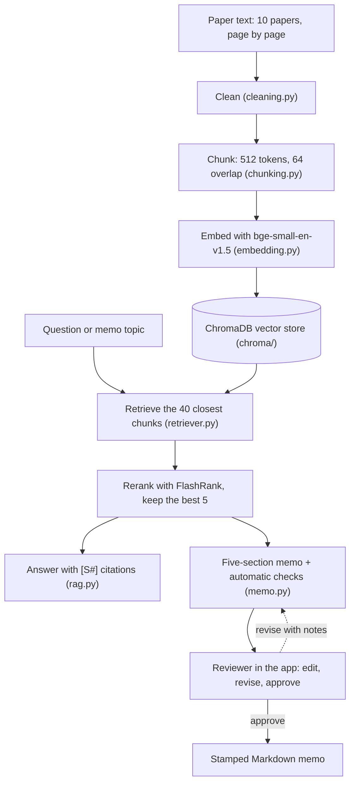

# Agentic Internal Knowledge System for R&D

A local research assistant for Zayi's R&D engineers. It turns 10 curated ArXiv
ML papers into a searchable knowledge base. From that base it answers
questions and drafts structured triage memos. Every claim is cited to the
paper and page it came from, and a reviewing engineer can edit, revise or
approve each memo before it is used.

### 👥 Team Members

| Name | GitHub Handle | Contribution |
|---|---|---|
| Deyon Wijewardana | @Ranidnu-W | Core project implementation, token-aware chunking, embeddings, ChromaDB knowledge base, retrieval evaluation, collection lifecycle fixes, reranking work, and repo-level maintenance |
| MatthewZ1 | @MatthewZ1 | Corrected corrupted figure text, fixed ReAct paper OCR issues, updated data-source handling, and contributed to the corrected dataset workflow |
| Brayden Uglione | @BrantisIsHacking | Updated text-cleaning and chunking notebooks, consolidated data-cleaning files, supported testing, and developed task delegation and progress tracking |
| Tharun Kumar Malla Dinakaran | @Thxrunn | Developed EDA and text preprocessing notebooks to analyze, clean, validate, and prepare the research paper dataset for the RAG pipeline. |
| Atai Kydyrov | @atai20 | Findings formatting, markdown cleanup, notebook updates, and research-paper analysis documentation |
| Claire Moon | @cmoon07 | Tested reference-page filtering against the retrieval eval set |
| joseambrosioo | @joseambrosioo | Challenge project overview updates and project coordination documentation |
| hari-bttai | @hari-bttai | Initial repository commit and project scaffolding |

---

## 🎯 Project Highlights

- End-to-end local pipeline: cleaned paper text → token-aware chunks →
  `bge-small` embeddings in ChromaDB → FlashRank reranking → Gemini answers
  with `[S1]`-style citations that point at specific paper pages.
- Triage memos with a human-in-the-loop review step: five fixed sections,
  automatic checks, then edit, revise with notes, or approve and download.
- Browser app (Gradio) and command-line tool built on the same pipeline.
- Measured retrieval: reranking 40 candidates finds a page holding the answer
  in the top 5 for 36 of 40 ground-truth questions (31 without reranking).
- Test suite (195 tests, no API key needed) covering every module.

## Contents

- [Quickstart](#quickstart)
- [How it works](#how-it-works)
- [Module map](#module-map)
- [Usage](#usage): [command line](#command-line), [browser app](#browser-app), [Python](#python)
- [Configuration](#configuration)
- [Evaluation and reproducing the numbers](#evaluation-and-reproducing-the-numbers)
- [Testing](#testing)
- [Troubleshooting](#troubleshooting)
- [Data](#data), [Notebooks](#notebooks), [Repository structure](#repository-structure)
- [Project context and status](#project-context-and-status)

## Quickstart

Requires Python 3.10 or newer (developed on 3.12). From a terminal:

```bash
git clone https://github.com/Break-Through-Tech/Zayi-1B-agentic-internal-knowledge-system-for-r-and-d.git
cd Zayi-1B-agentic-internal-knowledge-system-for-r-and-d
python -m venv venv
source venv/bin/activate          # Windows: venv\Scripts\activate
pip install -r requirements.txt
cp .env.example .env              # then paste a Gemini key from https://aistudio.google.com/apikey
python scripts/app.py             # opens http://127.0.0.1:7860
```

The first run downloads the embedding and reranking models (about 150 MB) and
builds the vector store in `chroma/` (about a minute). Later runs start in
a few seconds.

No key yet? Retrieval works without one:

```bash
python scripts/ask.py "How does LoRA reduce trainable parameters?" --retrieve-only
```

## How it works



1. **Clean.** `src/cleaning.py` fixes the PDF-extraction artifacts measured
   in the dataset: ligatures, control characters left by failed math
   glyphs, stray Windows-1252 bytes, and words hyphenated across lines.
2. **Chunk.** `src/chunking.py` splits each page into chunks of up to 512
   tokens with 64 tokens of overlap. It measures length with the embedding
   model's own tokenizer, so no chunk is silently truncated. By default
   chunks never cross a page, so every chunk cites exactly one page.
3. **Embed and store.** `src/embedding.py` turns each chunk into a 384-number
   vector with `BAAI/bge-small-en-v1.5`, and `src/knowledge_base.py` stores
   them in a ChromaDB collection (cosine distance). The collection records a
   hash of the corpus and the model. If the data or the chunking changes,
   the store is rebuilt instead of serving stale results.
4. **Retrieve.** `src/retriever.py` embeds the question and fetches the 40
   most similar chunks. That fast first pass isn't precise.
5. **Rerank.** A local cross-encoder (FlashRank,
   `ms-marco-MiniLM-L-12-v2`) reads the question and each candidate together
   and re-scores them. The best 5 go to the model. This step moved the right
   page into first place for 0.28 → 0.58 of questions
   ([details](data/eval/retrieval_tuning_report.md)).
6. **Generate.** `src/rag.py` numbers the excerpts `[S1]`–`[S5]` and asks
   Gemini to answer from them only, citing each claim. The labels use an `S`
   prefix because the papers are full of their own `[12]`-style references.
   Rate limits and server errors are retried with backoff. A used-up daily
   quota is not retried. Every citation is checked against the retrieved
   sources, and invalid or missing citations are flagged.
7. **Memo and review.** `src/memo.py` uses the same excerpts and labels to
   write a memo with five fixed sections. It then checks three things: all
   sections are present, every citation points at a retrieved excerpt, and
   every section is cited or marked "Not covered in the retrieved excerpts".
   In the app the reviewer can edit the draft, send it back with notes (the
   model writes a revision from the same excerpts), or approve it. Approval
   downloads a Markdown file stamped with the date and the reviewer's notes.

The pipeline is deliberately linear (no agent loop), so every step is
testable on its own and every answer can be traced to its excerpts.

## Module map

| File | What it does | Main entry points |
|---|---|---|
| `src/data_io.py` | Loads the paper JSON into flat page records (prefers the corrected file) | `load_pages`, `DEFAULT_DATA_PATH` |
| `src/cleaning.py` | Text cleanup for extracted PDF pages | `clean_pages`, `clean_text` |
| `src/chunking.py` | Token-aware chunking with page provenance | `ChunkingConfig`, `build_chunks` |
| `src/embedding.py` | Loads `bge-small` once, embeds passages and queries | `embed_texts`, `embed_query` |
| `src/knowledge_base.py` | ChromaDB build, freshness check, search, FlashRank rerank | `build_knowledge_base`, `search` |
| `src/retriever.py` | LangChain retriever; opens or builds the store on demand | `get_retriever`, `PaperRetriever` |
| `src/retrieval_eval.py` | hit@k and MRR over labeled queries | `evaluate_retrieval` |
| `src/rag.py` | Prompt, LLM setup (Gemini or OpenRouter), retries, citation checks | `answer_question`, `build_rag_chain`, `validate_citations`, `citation_warning` |
| `src/memo.py` | Triage memo drafting, revision, checks and Markdown export | `build_memo`, `draft_memo`, `revise_memo`, `check_memo`, `memo_document` |
| `src/ui.py` | Gradio app: chat thread, source cards, memo review panel | `build_app` |
| `scripts/ask.py` | Command-line answers, memos and retrieval-only debugging | see `--help` |
| `scripts/app.py` | Launches the browser app | `--port`, `--no-browser` |
| `scripts/run_rag.py` | Minimal Python example of one answer | |
| `scripts/evaluate_rag.py` | End-to-end eval on the 40 ground-truth questions (uses the API) | `--limit`, `--rerank`, `--output`, `--resume` |
| `scripts/generate_eval_report.py` | Builds `evaluation_report.md` from the eval output and manual grades | |
| `scripts/run_gt_retrieval_eval.py` | Page-level retrieval eval on the 40 questions (no API calls) | |
| `scripts/run_retrieval_sweep.py` | Chunk-size and rerank sweep on the sample query set (no API calls) | |
| `scripts/test_reference_filtering.py` | Experiment: does dropping bibliography pages help retrieval? | |
| `scripts/compare_evaluations.py` | October vs final comparison tables from saved results (no API calls) | |
| `scripts/evaluate_memos.py` | Memo evaluation: one memo per paper, checks, citation precision, review verdicts | `--resume`, `--report` |

## Usage

### Command line

From the repo root, with the virtual environment active:

```bash
python scripts/ask.py "How does Self-RAG decide when to retrieve?"
python scripts/ask.py "How does Self-RAG decide when to retrieve?" --retrieve-only   # no API key needed
python scripts/ask.py "FlashAttention for long-context training" --memo > memo.md    # triage memo
```

| Option | Default | Meaning |
|---|---|---|
| `--k` | 5 | Excerpts given to the model |
| `--no-rerank` | off | Skip FlashRank (faster, less accurate) |
| `--rerank-pool` | 40 | Candidates the reranker re-scores |
| `--provider` | `gemini` | `gemini` or `openrouter` |
| `--model` | from `.env` | Override the model name |
| `--retrieve-only` | off | Print the excerpts without calling the model |
| `--memo` | off | Draft a triage memo (Markdown on stdout; failed checks on stderr) |

Each answer or memo is one API call.

### Browser app

```bash
python scripts/app.py              # http://127.0.0.1:7860
python scripts/app.py --port 8000 --no-browser
```

- **Answer** (default) retrieves excerpts and has Gemini answer from them.
  Each citation is a chip that jumps to its source card. The card shows the
  excerpt and links to that page of the PDF. Sources the answer didn't use
  are dimmed, and a citation that points at no retrieved source is flagged.
  The collapsible steps above each answer show what was retrieved and how
  long each step took.
- **Memo** drafts a triage memo on a topic. It has five sections: Bottom line,
  Key findings, How it works, Evidence and results, Limitations and open
  questions. The automatic checks appear above the memo. Below it, the
  review panel holds the draft as editable Markdown plus reviewer notes.
  **Revise with notes** sends the draft (with any edits) and the notes back
  to Gemini, which writes a revision from the same excerpts as a new turn.
  **Approve and download** saves the memo with an approval stamp, the date,
  the notes, and whether the reviewer edited it.
- **Search only** shows the closest excerpts without calling Gemini, so it
  needs no key and uses none of the daily quota.
- The composer sets the number of excerpts and turns reranking on or off.
  Each question is answered on its own: earlier turns are not sent to the
  model. **New chat** clears the page. **Download .md** saves an answer with
  its sources.
- Math is typeset with KaTeX from a CDN (shown as plain TeX when offline).
- Background photo: green aurora over Snæfellsnes, Iceland, by Jack Anstey on
  [Unsplash](https://unsplash.com/photos/MiUyKAHP90s) (Unsplash License).

### Python

```python
from src.rag import answer_question, citation_warning
from src.memo import build_memo, memo_document

result = answer_question("How does Self-RAG decide when to retrieve?")
print(result["answer"])
for s in result["sources"]:
    print(s["n"], s["paper_title"], s["page_start"], s["page_end"])
if warning := citation_warning(result["citations"]):  # invalid [S#] or no citations
    print("warning:", warning)

memo = build_memo("LoRA for fine-tuning large models")
print(memo["passed"], [c for c in memo["checks"] if not c["ok"]])  # automatic checks
print(memo_document(memo))                             # Markdown with a Sources list
```

Retrieval on its own (no API key):

```python
from src.retriever import get_retriever

retriever = get_retriever(k=5, rerank=True)
for doc in retriever.invoke("How does LoRA reduce trainable parameters?"):
    print(doc.metadata["paper_title"], doc.metadata["page_start"], doc.page_content[:80])
```

Each result is a LangChain `Document`. `page_content` holds the chunk text, and
`metadata` holds `chunk_id`, `paper_id`, `paper_title`, `page_start`,
`page_end`, `similarity`, and `rerank_score` (when reranking is on).

Lower-level building blocks, for experiments with other chunk settings:

```python
from src.data_io import load_pages
from src.cleaning import clean_pages
from src.chunking import ChunkingConfig, build_chunks
from src.knowledge_base import build_knowledge_base, search

chunks = build_chunks(clean_pages(load_pages()), ChunkingConfig(chunk_size=256, chunk_overlap=32))
collection = build_knowledge_base(chunks)          # one collection per chunk config
for r in search(collection, "What is the role of retrieval in RAG?", k=5, rerank=True):
    print(r["paper_title"], r["page_start"], r["similarity"])
```

## Configuration

API keys and model choice live in `.env` (gitignored; copy `.env.example`):

| Variable | Default | Meaning |
|---|---|---|
| `GOOGLE_API_KEY` | none | Gemini key (default provider) |
| `GEMINI_MODEL` | `gemini-3.5-flash` | Gemini model name |
| `LLM_PROVIDER` | `gemini` | Set to `openrouter` to use the fallback provider |
| `OPENROUTER_API_KEY`, `OPENROUTER_MODEL` | none | Only for the OpenRouter fallback |

Pipeline defaults (in code):

| Setting | Default | Where | Why |
|---|---|---|---|
| Chunk size / overlap | 512 / 64 tokens, page scope | `ChunkingConfig` | Best page-level hit rate with reranking in the November eval |
| Embedding model | `BAAI/bge-small-en-v1.5` | `src/embedding.py` | Small, fast on CPU, strong retrieval for its size |
| Excerpts to the model (`k`) | 5 | `src/retriever.py` | A few corroborating excerpts without crowding the prompt |
| Reranking | on, pool of 40 | `src/retriever.py` | 36/40 page hits at 5 vs 35/40 with a pool of 20; costs about 2.9 s per question on a laptop CPU vs 1.4 s |
| Reranker | `ms-marco-MiniLM-L-12-v2` | `src/knowledge_base.py` | Local, no API calls |
| LLM temperature | provider default | `src/rag.py` | Google recommends leaving Gemini 3 models at their default |
| Retries | up to 4 attempts, exponential backoff | `src/rag.py` | Rate limits and 5xx only; daily quota and bad keys fail fast |

## Evaluation and reproducing the numbers

Every reported number can be regenerated from the repo. The retrieval
evaluations make no API calls. The end-to-end evaluation uses one Gemini call
per question.

| Result | Report | Command | API calls |
|---|---|---|---|
| Chunk-size sweep, September (sample query set) | `data/eval/sweep_results.json` | `python scripts/run_retrieval_sweep.py` | 0 |
| Reference-page filtering experiment | printed | `python scripts/test_reference_filtering.py` | 0 |
| End-to-end baseline, October: 27 correct / 9 partial / 4 wrong of 40; paper hit@5 95%; citation labels 100% valid | [`evaluation_report.md`](data/eval/evaluation_report.md) | `python scripts/evaluate_rag.py --limit 40`, then `python scripts/generate_eval_report.py` | 40 |
| Page-level retrieval and reranking, November: page hit@5 0.78 without rerank → 0.90 with a pool of 40 | [`retrieval_tuning_report.md`](data/eval/retrieval_tuning_report.md) | `python scripts/run_gt_retrieval_eval.py` | 0 |

Ground truth: `data/ground_truth_qa.json` (40 questions, 4 per paper, with
reference answers and keywords). `data/eval/ground_truth_pages.json` labels
the page(s) holding each answer's evidence.

Notes for a faithful rerun:

- `evaluate_rag.py` defaults reproduce the October baseline: reranking off,
  results in `data/eval/rag_evaluation.json`. That run used a Flash-Lite
  model, so for a like-for-like repeat set `GEMINI_MODEL` (or `--model`) to
  that model. The tuned pipeline runs with `--rerank` (pool 40, k = 5); write
  it to another file with `--output` so the October results stay intact.
- Besides paper-level hit@5, each record now has page-level hit@5, whether
  the answer cited an evidence page, and citation validity under the current
  rules (an uncited answer counts as invalid).
- Correctness grades are manual (`data/eval/manual_scores.json`; correct = 1,
  partial = 0.5, wrong = 0), so a new run needs regrading before
  `generate_eval_report.py`.
- 40 calls exceed the free tier's 20 requests a day. `--resume` skips
  questions already answered with the same settings, and a run stops cleanly
  when the daily quota runs out, so it can be split across days:
  `python scripts/evaluate_rag.py --limit 40 --rerank --output data/eval/final_rag_evaluation.json --resume`.
- Retrieval numbers are deterministic for a given corpus and config.

## Testing

```bash
pytest -q
```

The suite (195 tests) takes under a minute. It uses small in-memory
ChromaDB collections, the real embedding and reranking models, and fake
LLMs, so it needs no API key and makes no API calls. Once the models are
cached (after the first app or CLI run), it also runs offline. It covers chunking
boundaries, store freshness and rebuilds, retriever metadata, prompt and
citation parsing, retry behavior, memo checks and revisions, and the app's
rendering, including a syntax check of its JavaScript.

## Troubleshooting

| Symptom | Cause and fix |
|---|---|
| `429` / "daily API quota is used up" | Free-tier Gemini allows 20 requests a day per model, resetting at midnight Pacific. Use `--retrieve-only` or **Search only** meanwhile, set another `GEMINI_MODEL`, or switch to OpenRouter in `.env`. Per-minute limits are retried automatically. |
| "No Gemini API key found" / `401` / `403` | `.env` is missing or the key is wrong. It must sit in the repo root (next to `README.md`). |
| `NoSuchFile` or ONNX errors from FlashRank | A corrupted reranker download. The code deletes and re-downloads it once automatically; if it persists, delete `~/.cache/flashrank` and rerun. |
| Slow first question | Models load on first use (a few seconds), and the first ever run builds `chroma/` (about a minute). |
| Stale or odd results after changing data or chunking | The store rebuilds itself when the corpus hash changes. To force it: `get_retriever(rebuild=True)`, or delete `chroma/`. |
| `ModuleNotFoundError: src` in a notebook or script | Run from the repo root, or `export PYTHONPATH="$PWD"`. |
| `ModuleNotFoundError` for a package | The virtual environment isn't active, or `requirements.txt` changed: `pip install -r requirements.txt`. |
| Port 7860 in use | `python scripts/app.py --port 8000` |
| Math shows as raw TeX in the app | KaTeX loads from a CDN; it needs an internet connection. |

## Data

The 10 papers are stored as page-level text under `data/`:

- `curated_papers_text.json`: original extraction
- `curated_papers_text_corrected.json`: with corrupted figure pages fixed by
  OCR (used automatically when present; see `src/data_io.py`)
- `cleaned_papers_text.json`: cleaned per-page output from the preprocessing
  task
- `ground_truth_qa.json`: the 40-question evaluation set
- `eval_queries_sample.json`: the smaller labeled query set used for the
  September sweep
- `eval/`: evaluation outputs and reports

## Notebooks

- `notebooks/01_data_exploration.ipynb`: dataset inspection and EDA
- `notebooks/02_text_preprocessing.ipynb`: cleaning and normalization
- `notebooks/03_text_chunking.ipynb`: chunking experiments and statistics
- `notebooks/04_knowledge_base.ipynb`: embedding, ChromaDB indexing, sample searches

For a notebook kernel: `python -m ipykernel install --user --name zayi-rag`.

## Repository structure

```text
.
├── README.md
├── requirements.txt
├── pytest.ini                    # test discovery and import path
├── .env.example                  # copy to .env for API keys (gitignored)
├── Challenge-Project-Overview.md
├── Progress.md
├── FindingsOnResearchPapers.md
├── Getting-Started-for-Fellows.md
├── assets/                       # app logo and background photo
├── data/
│   ├── curated_papers_text.json
│   ├── curated_papers_text_corrected.json
│   ├── cleaned_papers_text.json
│   ├── ground_truth_qa.json
│   ├── eval_queries_sample.json
│   ├── eval/                     # reports, page labels, raw results
│   ├── images/
│   └── processed/
├── notebooks/                    # 01-04, see above
├── scripts/
│   ├── app.py
│   ├── ask.py
│   ├── evaluate_rag.py
│   ├── generate_eval_report.py
│   ├── run_gt_retrieval_eval.py
│   ├── run_rag.py
│   ├── run_retrieval_sweep.py
│   └── test_reference_filtering.py
├── src/
│   ├── data_io.py
│   ├── cleaning.py
│   ├── chunking.py
│   ├── embedding.py
│   ├── knowledge_base.py
│   ├── retriever.py
│   ├── retrieval_eval.py
│   ├── rag.py
│   ├── memo.py
│   └── ui.py
├── tests/                        # one file per module, plus citation and retry tests
└── chroma/                       # local vector store, generated at runtime (gitignored)
```

## Project context and status

- Host organization: Zayi. Challenge advisor: Jose Ambrosio.
- Program: Break Through Tech AI Studio, Fall 2026.
- Goal: let engineers query dense research papers, find the right passages
  and pages, and draft structured technical memos with citations that need
  minimal correction by the reviewing engineer.

| Milestone | Status |
|---|---|
| September: data review, EDA, cleaning, chunking, embeddings + ChromaDB | Done |
| October: retriever and baseline RAG pipeline, end-to-end evaluation | Done |
| November: page-level retrieval eval, reranking, citation reliability, browser app, triage memos with review | Done |
| November: final 40-question evaluation with the tuned pipeline | In progress |

Stretch goals from the project brief:

1. Local reranking with FlashRank: **done** (on by default).
2. Gradio UI with a human-in-the-loop approval step: **done** (memo review).
3. Deterministic evaluation: **done** for retrieval (hit@k, MRR, page-level
   hits) and citation validity, plus keyword recall. ROUGE/BLEU are not used,
   because exact-overlap scores reward wording rather than correctness.
4. Agentic self-correction with LangGraph: not started. The memo revision
   loop is a human-driven version of the same idea.

## License

This repository does not contain a license file. Confirm the appropriate
license with the challenge advisor before any public distribution.

## References

- Retrieval-Augmented Generation for Large Language Models: A Survey
- Dense Passage Retrieval for Open-Domain Question Answering
- Self-RAG: Learning to Retrieve, Generate, and Critique through Self-Reflection
- FlashAttention
- LoRA
- RAGAS
- ChromaDB documentation
- LangChain RAG documentation
